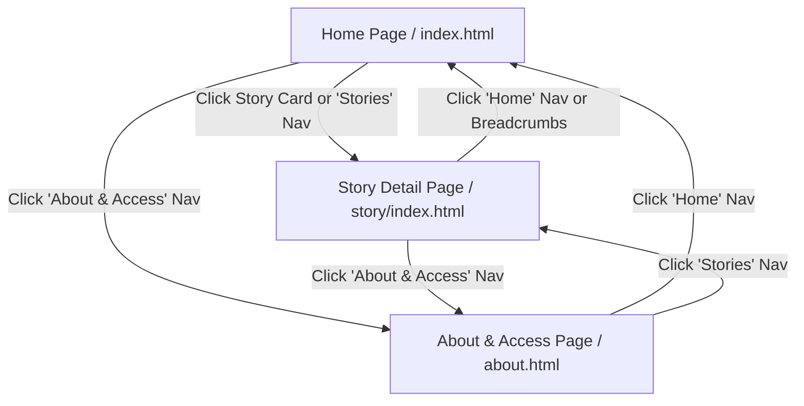

# StoryCast: Accessible Media Feature Microsite

StoryCast is a clean, accessible, 3-page web microsite built to showcase audio and video storytelling. The goal of this project is to make media content welcoming, easy to navigate, and fully accessible to everyone, including people using assistive technologies like screen readers or keyboard-only navigation.

This project was built from scratch using pure **Vanilla HTML5**, **Sass (SCSS)**, and a few lines of lightweight **Vanilla JavaScript**—with **no external frontend frameworks** (no React, no Tailwind, no Bootstrap).

---

## 🔗 Project Links & Design Artifacts

- **Figma Wireframes:** [StoryCast Wireframe](https://www.figma.com/design/jLhBC2z1o4UHmIzVNU9QyM/Story-Cast-Wireframe?m=auto&t=xumZIxgPNdn8F18n-1)
- **Figma High-Fidelity Prototype:** [StoryCast Prototype](https://www.figma.com/design/FAiYkp5KRzOjN3LxzpStDP/Story-Cast-Protype?m=auto&t=xumZIxgPNdn8F18n-6)

---

## 🗺️ Information Architecture & Sitemap

StoryCast consists of 3 core pages connected through a persistent navigation bar and clear breadcrumbs:

1. **Home Page (`index.html`)**: Introduces the platform, features the lead documentary, lists recent stories with quick playback buttons, and provides an accessibility intro.
2. **Story Detail Page (`story/index.html`)**: Features an accessible full video player, closed captions (`.vtt`), an interactive transcript reader, downloadable transcript button, and related stories.
3. **About & Access Page (`about.html`)**: Details the platform's accessibility commitments (captions, transcripts, keyboard-first controls, high contrast), mission statement, and a direct access team contact card.

### Sitemap Diagram



---

## 📁 Project Structure

The codebase is organized in a straightforward, modular layout:

```text
storycast/
├── index.html                     # Home page
├── about.html                     # About & Access mission page
├── story/
│   └── index.html                 # Story Detail page
├── assets/
│   ├── audio/
│   │   └── sample.mp3             # Audio media file
│   ├── video/
│   │   └── sample.mp4             # Video documentary file
│   ├── captions/
│   │   ├── tide-between-us.vtt    # WebVTT caption file for video
│   │   ├── made-by-hand.vtt       # WebVTT caption file
│   │   ├── after-last-train.vtt   # WebVTT caption file
│   │   └── about-mission.vtt      # WebVTT caption file for about page
│   ├── documents/
│   │   └── sample-transcript.pdf  # Downloadable transcript document
│   └── icons/
│       ├── logo.svg               # StoryCast circular microphone brand badge
│       ├── handshake.svg          # Access team support handshake icon
│       ├── play.svg               # Play button icon
│       ├── checkmark.svg          # Success checkmark icon
│       ├── pdf.svg                # Download PDF transcript icon
│       ├── instagram.svg          # Social media icon
│       ├── spotify.svg            # Spotify podcast icon
│       └── youtube.svg            # YouTube channel icon
├── sass/
│   ├── _colors.scss               # Design tokens: palette & contrast colors
│   ├── _typography.scss           # Design tokens: font families, sizes, weights
│   ├── _spacing.scss              # Design tokens: layout gaps and padding
│   └── main.scss                  # Main stylesheet importing tokens & partials
├── css/
│   ├── main.css                   # Compiled CSS stylesheet
│   └── main.css.map               # CSS source map for debugging
└── README.md                      # Project documentation and guide
```

---

## ♿ Accessibility Checklist (WCAG 2.1 AA Compliance)

Every requirement from the rubric has been implemented and tested:

- [x] **Semantic HTML5 Structure**: Used genuine structural tags (`<header>`, `<nav>`, `<main>`, `<article>`, `<section>`, `<figure>`, `<figcaption>`, `<footer>`) instead of generic `<div>` soup.
- [x] **Headings Hierarchy**: Every page starts with one `<h1>`, followed logically by `<h2>` and `<h3>` tags without skipping heading levels.
- [x] **Closed Captions (`<track>`)**: All video and audio elements feature working `<track kind="captions">` pointing to valid `.vtt` WebVTT caption files.
- [x] **Full Text Transcripts**: The story detail page includes a complete written transcript, synchronized speaker sections, and a download button for an offline PDF copy.
- [x] **Keyboard-First Navigation**:
  - A hidden "Skip to main content" link appears when tabbing (`:focus`).
  - Interactive elements (buttons, links, video player preview) are tab-accessible via native focus or `tabindex="0"`.
  - Accessible keyboard event listeners (`Enter` and `Space`) activate controls.
- [x] **High Contrast (WCAG AA & AAA)**:
  - Charcoal black text (`#1A1A1A`) on white (`#FFFFFF`) gives a **16.1:1** contrast ratio (exceeds AAA requirement).
  - Slate secondary text (`#5C6B73`) on white (`#FFFFFF`) gives a **5.2:1** ratio (exceeds AA requirement).
  - Black text (`#1A1A1A`) on bright yellow accent (`#F9D423`) gives an **11.8:1** ratio (exceeds AAA requirement).
- [x] **ARIA Support**:
  - `aria-label` used to describe icon-only buttons and media players.
  - `aria-expanded` and `aria-controls` for mobile navigation toggle.
  - `aria-current="page"` to indicate active pages in navigation and breadcrumbs.
  - `aria-hidden="true"` applied to purely decorative icons to prevent screen reader clutter.

---

## 🎨 Sass & CSS Architecture

The stylesheet architecture follows clean, maintainable best practices:

1. **Design Tokens & Partials**:
   - `sass/_colors.scss`: Defines accessible color variables (`$color-primary`, `$color-accent`, `$color-secondary`, etc.).
   - `sass/_typography.scss`: Defines font families (`Inter`), scale (`$font-size-hero`, `$font-size-2xl`), and weights.
   - `sass/_spacing.scss`: Defines spacing scale (`$space-xs` through `$space-8xl`).
2. **Modern CSS Features**:
   - **CSS Grid & Flexbox**: Clean, fluid responsive layouts.
   - **CSS Container Queries**: Story cards use `@container storycard (min-width: 640px)` so cards adapt based on their own container width, switching seamlessly between vertical and horizontal layouts.
   - **Cascade Layers (`@layer`)**: Styles are grouped into `@layer reset, base, components, layouts, utilities` to keep specificity predictable and maintainable.
   - **BEM Naming**: Consistent Block-Element-Modifier syntax (e.g. `.story-card`, `.story-card__content`, `.btn--primary`, `.nav-link--active`).

---

## 💻 Instructions for Running Locally

You do not need to install complex frameworks or build pipelines to run this project.

### 1. Clone the repository
```bash
git clone https://github.com/charleswereangoye/storycast.git
cd storycast
```

### 2. Run a local web server
Because modern browsers restrict certain media and caption tracks (`.vtt`) when opened directly via `file://`, run a simple local HTTP server:

**Using Python (recommended):**
```bash
python3 -m http.server 8000
```
Then open your browser and navigate to:
```text
http://localhost:8000
```

**Using VS Code Live Server:**
If you use VS Code, right-click `index.html` and choose **"Open with Live Server"**.

**Using Node / npx:**
```bash
npx serve .
```

### 3. (Optional) Recompiling Sass styles
If you edit any files in the `sass/` directory, recompile `css/main.css` using Sass:
```bash
npx -y sass sass/main.scss css/main.css
```
Or watch for changes in real time:
```bash
npx -y sass --watch sass/main.scss:css/main.css
```
